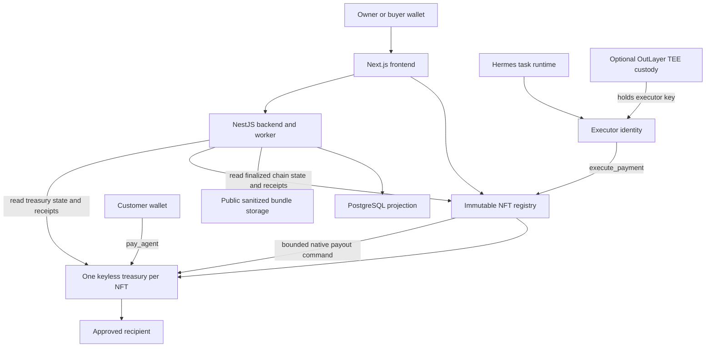

# Nivry: Architecture and Seven-Day Build Plan

Draft v0.3. Architecture selected for implementation; not a claim that the contracts or integrations already exist.

**Product:** a transferable AI-agent identity whose NFT controls a permanent, keyless NEAR treasury and revocable execution permissions.
**Primary track:** `nfts`. Consider `agents` and `security` only for features actually demonstrated.
**Network:** NEAR testnet only. No mainnet fallback.
**Stack:** Rust smart contracts, Next.js frontend, NestJS backend, TypeScript tooling, PostgreSQL projection.
**Team:** Nebulaz — contracts and final UX; Dev B — backend, runtime adapter and first-pass UX.
**Delivery budget:** seven working days maximum; compress/cut if fewer remain. Hackathon deadline from `HACKATHON.md`: 14 Nov 2026, 23:59 UTC; target submission: 13 Nov. The delivery clock below is relative, not a claim about today's date.

## 1. What we are building, in simple words

An agent is a robot. Its NFT is the ownership card. Its treasury is a money box with no ordinary master key.

The money box obeys fixed contract rules. Those rules let the current card holder control it and appoint a limited agent operator. Selling the card removes the old operator's permission. The buyer appoints a new operator. The money box, address, published configuration and recorded history stay with the identity.

**The buyer cannot install a permanent key, replace these rules, or give a delegate permission that survives the next ownership change.** We prevent those actions; we do not merely display a warning after they happen.

### Core demonstration

1. Mint an agent NFT and provision its own treasury account.
2. Publish a sanitized agent bundle; show its content hash in the passport.
3. Authorize a bounded executor and complete one useful task.
4. A customer pays the treasury through `pay_agent`; the passport shows a recorded payment.
5. Demonstrate one executor-authorized payment from the treasury.
6. List the agent; settle pending operations before listing.
7. Buyer purchases it. The same treasury and remaining funds stay attached.
8. Seller's still-running executor attempts another payment and is rejected.
9. Buyer authorizes a fresh executor; its bounded payment succeeds.
10. Passport shows unchanged agent/treasury identity, changed owner/authority epoch, and history attributed to each epoch.

The demo task is a repository documentation report using public or bundled fixture input. This is not an arbitrary remote-code execution or repository cloning platform. A customer payment is not proof of task quality or an escrow agreement.

## 2. Decisions and changes from v0.2

| Decision | Selected approach | Reason |
| --- | --- | --- |
| Execution environment | Native NEAR WASM | Direct NEP-171 integration; no Aurora/EVM layer |
| Contract language | Rust with compatible stable `near-sdk` / `near-contract-standards` | Native NEAR patterns, type-safe accounting, existing NFT implementation |
| Treasury | One keyless contract account per NFT | A real stable address, not a balance label in one shared account |
| Ownership authority | Nivry NFT registry is the single source of truth | No duplicated wallet-owner cache or asynchronous owner synchronization |
| Account protection | Locked registry and locked wallets; no upgrade/key-management paths | Buyer cannot bypass later NFT transfers |
| Marketplace | Fixed-price methods inside registry | NFT ownership and seller credit update within one receipt |
| Executor | One active identity per agent authority epoch | Easy revocation, narrow permissions |
| TEE | Optional OutLayer custody executor, not the treasury | Avoids transferring custody keys or depending on off-chain freeze for sale safety |
| Runtime | Hermes adapter for one task | Runtime is replaceable, not the authority |
| Published bundle | Public, sanitized, content-addressed | Buyer retrieval without an encryption/key-exchange project |
| Payments | Native testnet NEAR only | No Intents, FT allowances, bridging or oracle dependencies |
| Backend | One NestJS deployment with bounded worker + PostgreSQL | Projection and task coordination, never ownership authority |
| Standardization | Local dependent-NEP draft after core tests pass | Implementation first; no claim of accepted standard |

Superseded: fresh **treasury** after sale; deleting a local key as revocation; transferring OutLayer wallet ownership; mainnet fallback; separate marketplace contract; mandatory broad CLI; mandatory governance post. Fresh **executor** after sale is intentional and does not change the treasury address.

Choose actual compatible tool versions when scaffolding, commit Rust and JS lockfiles, and record the tested toolchain. Do not use floating `latest` dependencies or invent unverified versions here.

## 3. Architecture map



Arrows represent calls or reads, not synchronous execution or global transaction atomicity. Browser wallets submit owner actions directly to chain. The backend cannot invent ownership, authorize spending, or bypass the registry.

### Identity versus signing keys

An NFT does not itself require a private key. The canonical identity is `(network, registry_account_id, token_id)`; the canonical treasury is a separate keyless account bound to that identity.

The optional TEE holds the **executor's** signing key. That key submits requests; it is never installed as an access key on the treasury or registry. Losing or copying it cannot create a permanent treasury backdoor. While it remains authorized, compromise can still spend within its on-chain grant.

## 4. Contract module A: NFT registry, controller and sale

One Rust WASM combines NFT title, factory, executor grants and the small sale market. Use the established NEP-171 implementation and extensions where possible, but route every ownership transition through the same Nivry guards.

### Authoritative per-agent state

| Field | Meaning |
| --- | --- |
| `token_id`, `owner_id` | NEP-171 title and current owner |
| `treasury_account_id` | Immutable binding, unique per token |
| `treasury_code_hash` | Expected deployed wallet implementation |
| `manifest_uri`, `manifest_hash` | Fixed published bundle reference for MVP |
| `authority_epoch` | Monotonic authorization generation; NOT NEAR's blockchain epoch |
| `ownership_change_count` | Counts ownership changes, not distinct people |
| `lifecycle` | Provisioning, ready, or failed/uncertain provisioning |
| `frozen` | Current owner's emergency stop for outgoing wallet commands |
| `executor_grant` | Optional executor, epoch, recipients, caps and expiry |
| `next_command_nonce` | Monotonic application nonce; never reset/reused |
| `pending_operation` | At most one wallet command for this token |
| `pending_transfer_call` | Transfer operation ID and temporary financial freeze |
| `listing` | Optional seller, epoch, listing ID, price and manifest commitment |

Bound all strings/arrays/metadata and charge storage deposits. Keep history in events, not unbounded vectors in contract state. Expose paginated reads. Counters use checked arithmetic; amounts use integer yoctoNEAR serialized as decimal strings. Fix protocol maxima on Day 1 (recipient count, manifest bytes, pagination, grant lifetime and callback result size); validate them on-chain and share the limits with clients. Use decimal nanoseconds for deadlines and document units explicitly.

### Proposed public interface

These are planned Nivry methods, not existing NEAR standards or deployed endpoints.

| Method | Caller and effect |
| --- | --- |
| `create_agent(manifest, expected_cost)` | Owner-funded asynchronous keyless treasury provisioning; token not usable until confirmed |
| `agent_info(token_id)` | Title, treasury binding, epoch, capabilities and lifecycle |
| `set_executor(token_id, expected_epoch, grant)` | Current owner only; rotates authority generation and installs bounded grant |
| `revoke_executor(token_id, expected_epoch)` | Current owner only; increments generation and removes grant |
| `set_frozen(token_id, expected_epoch, frozen)` | Owner stop/unstop; freezing invalidates existing grant, unfreeze does not restore it |
| `execute_payment(token_id, expected_owner, authority_epoch, nonce, recipient, amount, deadline)` | Authorized executor only; validates and dispatches bounded payment |
| `owner_withdraw(token_id, expected_epoch, nonce, recipient, amount)` | Owner only; same pending-operation and treasury reserve rules; not an executor grant |
| `list_agent(token_id, expected_epoch, price)` | Owner only; no pending operations; freezes outgoing treasury commands while listed |
| `cancel_listing(token_id, listing_id)` | Current owner only; removes listing, does not restore a cleared grant |
| `buy_agent(token_id, listing_id, expected_epoch, expected_manifest_hash)` | Buyer attaches exact price; credits seller, changes title and invalidates execution authority |
| `withdraw_sale_proceeds(amount)` | Seller claims their registry-held credit through reservation and callback settlement |
| `reconcile_operation(token_id, operation_id)` | May trigger a fixed wallet-status query; never accepts a caller-asserted outcome |
| Standard NFT methods | NEP-171 transfer/transfer-call, metadata, enumeration and approvals |

Owner changes require current-owner **predecessor** authentication and the wallet security deposit convention where appropriate. An NFT approval authorizes NFT transfer only, never treasury spending or grant changes. The executor is authenticated by `predecessor_account_id`, not a supplied owner string or `signer_account_id` passing through an arbitrary helper.

### All authority changes use one rule

Ownership change, executor replacement/revocation and emergency freeze advance `authority_epoch` and clear the old grant. New grants are installed against the resulting generation. Expected-epoch arguments prevent stale UI/job actions from modifying newer authority. Define returned epoch values explicitly in the generated client.

Transfer A → B → A never revives A's previous permission. The epoch is public, not a password: knowing the new number does not let an old executor create a new grant.

Only one active executor per agent; prevent an executor from being actively shared between tokens in MVP. Frontend always provisions a fresh buyer-controlled executor after sale. Reauthorizing a seller-accessible executor would deliberately grant the seller access again; the UI must not encourage reuse.

## 5. Contract module B: immutable keyless treasury

A second, deliberately small Rust WASM is deployed once per NFT as a direct child of the registry. Child labels derive from reserved numeric IDs and must satisfy account-length constraints; final addresses are generated by the deployed factory, not hard-coded in this plan.

### Treasury state and interface

- Immutable registry account and token ID.
- Explicit reserved storage/operating balance and spendable native balance rules.
- Bounded latest-operation record and monotonic command sequence, sufficient for active-operation reconciliation and duplicate rejection.
- Aggregate recorded service-payment amount/count; detailed history in events.
- `pay_agent(payment_reference_hash, observed_authority_epoch)` — payable customer receipt, logs payer and amount. Client-supplied epoch is labeled observed, not trusted ownership evidence. Projection joins authoritative finalized registry history and preserves ordering uncertainty.
- `deposit()` — payable funding, explicitly not service revenue.
- `dispatch_native(operation_id, sequence, authority_epoch, recipient, amount)` — only fixed registry predecessor, no caller-selected action/method/callback.
- `operation_status(operation_id)` and `treasury_info()` — bounded views.
- Private native-transfer finalization callback; emits succeeded/failed status.

The wallet **does not cache an owner** or accept commands directly from an NFT owner/executor. It trusts only the immutable registry, which performs the fresh ownership check before dispatch. This avoids a sale requiring an external wallet rebind.

It accepts only native transfers for outgoing actions. No generic promise forwarding, arbitrary function calls, FT approvals, key actions, deployment, deletion, rebinding or administrative recovery. Recipients are fixed in the command and validated before scheduling. Storage reserve is not withdrawable.

`dispatch_native` returns the complete `transfer.then(finalize)` promise chain, so the registry callback waits for the wallet's terminal result, not merely command acceptance. Terminal results include the operation ID and outcome.

### Receiving money honestly

`pay_agent` records that native NEAR was received, not that work was delivered or a customer was independent. Ordinary native transfers can reach the account without invoking contract code; they increase its actual balance but do not become recorded service revenue. Funding and sale proceeds are separate categories.

Do not claim general asset-wallet support: FTs/NFTs sent to these accounts may be inaccessible in MVP. UI and README warn to send **testnet native NEAR only**. No automated refunds/arbitration are included.

## 6. Why Bob cannot install a permanent backdoor

Enforcement is structural, not an off-chain promise:

1. Treasury creation batch performs `CreateAccount`, funding, fixed WASM deployment and initialization, with **no AddKey actions**.
2. Treasury initialization is one-time and bound to its creating registry; no public reinitializer.
3. Treasury code exposes no upgrade, key-addition, account-deletion, controller-replacement or arbitrary self-action method.
4. Registry code exposes no generic factory deployment parameter, registry upgrade, key management, arbitrary dispatch or owner/admin override.
5. Once a tested registry release is ready, remove **all access keys** from its account with explicit operator confirmation.
6. Use direct deployed code or a code-hash-pinned global contract, never a mutable global-contract-by-account-ID reference.
7. Record actual final code hashes, empty access-key lists and immutable bindings using RPC. Frontend shows `development/unverified` until this is verified; only then show `locked release`.
8. Owner powers are limited to title, listing, freeze, bounded delegation and withdrawals. They cannot change the control rules.

The parent account name is not a recovery key: NEAR parents do not automatically control child accounts.

**Trade-off:** immutability also makes bugs permanent. Test mutable development deployments first, then publish a separately identified locked release. A new release does not silently replace an old treasury or migrate its binding. No claim of production safety, audit, unhackability or protection from protocol-level failure.

OutLayer never gets keys on these accounts. Its own provider/recovery trust model applies to the replaceable executor identity, not a new permanent control path over the treasury.

## 7. Provisioning lifecycle

Factory actions occur asynchronously; the registry and child are not one global atomic transaction.

```text
RESERVED / PROVISIONING
  -> child create + fund + deploy + init batch
  -> confirmed success -> mint ready NFT, publish binding
  -> confirmed batch failure -> failed reservation + refundable funded liability
  -> missing/failed callback -> uncertain; reconcile fixed child init/binding
```

Reserve token IDs monotonically and never recycle them. Do not expose a transferable token or active executor before confirmation. Fund measured code/state storage and reserves; do not guess a fixed mint price or hide creation costs.

A child batch is atomic within its own receipt, not with registry callbacks. Reconciliation verifies the expected child and exact initialization/binding through a fixed query; backend/RPC observations alone do not authorize a refund or mark on-chain success. Child success plus failed registry callback must not lead to a refund AND an active funded treasury. Failed provisioning refunds use their own reserved-credit withdrawal logic.

Keep factory commitments, refundable liabilities and registry storage separately accounted. No child balance can back a registry refund or seller credit.

## 8. Spending, concurrency and callback failures

### Authorization sequence

At the registry receipt:

1. Require ready token; no listing, financial transfer-call lock or pending command; not frozen.
2. Require expected owner and epoch match authoritative state.
3. Authenticate actual predecessor as current executor, with matching stored grant/epoch.
4. Check exact next nonce, expiry, positive amount, recipient allowlist, per-payment cap and remaining cumulative grant budget.
5. Consume nonce and reserve grant budget; record immutable operation fields and set per-token pending lock **before** emitting a promise.
6. Send a fixed command to that token's bound treasury.
7. Wallet validates registry and monotonic command sequence, reserves amount against storage-safe liquidity, performs native transfer and finalizes result.
8. Private registry callback settles that exact operation. A proven failed transfer restores reserved grant budget; a nonce is never reused. Both proven success and proven failure can release the lock.

Owner withdrawals take the same dispatch path without the executor budget. New commands for this token are serialized. Separate agents can proceed independently. An executor's gas balance or OutLayer deposit cap is NOT a cap on what our treasury can spend; Nivry's on-chain grant is the enforcement point.

### Handoff rule

**No ownership transfer or listing while a treasury command is unresolved.** Therefore a sale cannot race an already-approved payout. An old request queued outside the contract that arrives after transfer fails the new owner/epoch/grant check. If its on-chain authorization happened first, the transfer waits for settlement.

While pending, reject grant changes and financially relevant mutations. An emergency freeze may invalidate future authorization immediately, but does not cancel an emitted payment or clear its pending record. If a token is listed, emergency freeze atomically cancels that listing before advancing the epoch. Do not overwrite operation data on freeze.

### Failed callback rule

Callbacks are private, bounded, idempotent, operation-ID checked and provisioned with measured gas. Never interpret a failed promise chain as proof that the native transfer itself failed: it may have succeeded before finalization failed.

- If wallet has a persisted terminal outcome, an authenticated fixed status query can settle a lost registry callback.
- If native transfer completed but wallet finalization failed, wallet status may remain pending. **A status query alone cannot recover the missing outcome.**
- Do not infer failure from timeout, account balance, backend assertion or `NotFound`; never blindly retry or refund.
- Uncertain outcomes remain fail-closed. Receipt-proof recovery is out of scope for seven days. Such an agent can remain frozen; document this explicit testnet limitation. A replacement demo deployment is a different identity, not recovery of the original treasury.

This failure mode is a known availability risk, not a hidden admin escape hatch. Include forced callback-failure tests before locking a release.

## 9. NFT transfer and transfer-call behavior

### Direct and approved transfers

Common internal transition logic requires ready/no pending command/no unresolved transfer-call. A listed token cannot be directly transferred until listing is canceled; inline purchase is the only listed transition. On transfer:

- Update NFT owner and ownership-change counter.
- Increment authority epoch and clear executor/reverse mapping.
- Clear relevant sale state and standard NFT approvals as required.
- Preserve treasury address, funds, manifest and historical events.
- Leave buyer without an executor; buyer separately authorizes one.

### `nft_transfer_call`

Implement the standard path, not just a stub:

1. Require no pending command/listing/other transfer-call.
2. Move title provisionally, clear executor, advance epoch and record transfer operation.
3. Block treasury execution, owner withdrawals, grants, listing, forwarding/direct transfer and manifest changes until resolution. Deposits remain possible.
4. Call receiver and resolve its response using standard NEP-171 rules: `false` accepts; `true`, invalid response or failed receiver call returns the token.
5. On return, restore standard NFT approvals/approval IDs as required, but **never restore executor grants or roll back authority generation**. Preserve monotonic approval allocation.
6. Clear financial lock only through the matching private resolver.

Blocking receiver forwarding during resolution is an intentional composability restriction. Do not claim compatibility with every marketplace/receiver. Test the actual supported sale path and disclose restrictions.

Resolver failure is another fail-closed availability case; no timeout/admin unlock based on an unproven receiver outcome. If this cannot be implemented and tested in time, explicitly label the release a restricted prototype, **not full NEP-171 core support**. Do not silently advertise compliance.

No burn, token-ID reuse, royalty extension, owner recovery, external marketplace integration or cross-chain mirroring in MVP.

## 10. Sale and settlement semantics

### Listing

Require owner, ready state and no pending operations. Listing freezes all outgoing treasury commands, owner withdrawals and authority changes until cancellation/purchase. Fixed manifest remains unchanged throughout MVP. Incoming deposits are allowed, so total balance can increase; do not promise an exact immutable sale-time balance.

Store listing ID, seller, authority epoch, exact native price and manifest hash. All buys bind these values. Show treasury address, latest finalized balance/storage reserve, listing lock, grant state and code verification before purchase. Sellers can withdraw before listing; buyers must inspect what is actually being sold.

### Purchase: what is atomic

Buyer attaches exactly the listing price. In **one registry receipt**, validate listing, consume it, assign title, increment epoch, clear old executor, and credit seller's claimable sale proceeds.

No external seller payout or OutLayer call is required for ownership change. The child treasury does not rebind; it still accepts only its fixed registry. Seller credits are a pull-payment liability in the registry, separate from agent funds.

Seller withdrawal reserves/debits credit before its asynchronous transfer; confirmed failure restores it, uncertain callback failure does not create a second withdrawable credit. Registry solvency must cover storage + seller/refund credits + pending payouts + factory commitments, without counting child wallets.

Exact-price attachment avoids an overpayment-refund path. Prepay/charge seller-credit storage at listing rather than unexpectedly consuming buyer sale funds. Marketplace fee is zero for MVP. There is no promise that purchase and an external bank/wallet payout roll back together.

## 11. OutLayer TEE executor: optional, narrowly scoped

### Desired integration

For each active token/epoch, provision an independently registered OutLayer testnet custody identity. Its key is derived/used through OutLayer's TEE custody design; its implicit NEAR account holds only a small testnet gas float. The NFT owner authorizes that identity in Nivry.

Hermes requests a documented custody call to `execute_payment` on the registry. Registry authorization remains identical whether the caller uses OutLayer or a local test executor.

Documented candidate interface: `POST https://testnet-api.outlayer.ai/wallet/v1/call`. This is a research finding, **not a successfully tested integration**. Confirm current schema, raw gas units, funding, policy and actual receipt predecessor during the spike. No Intents, personal-account binding, lease mode, custody controller transfer, vault recovery, custom raw signing or dedicated enclave per NFT is needed.

### Day-one go/no-go gate — maximum four hours

- Register two independent testnet identities and verify distinct executor accounts.
- Fund testnet gas and perform a diagnostic direct call; inspect actual predecessor and complete receipts.
- Configure supported policy to allow only required registry calls where possible.
- Execute a real bounded treasury payout.
- Transfer NFT, reject the old executor, authorize the new executor, succeed.
- Record source/build/attestation evidence available for the actual deployment; distinguish a provider custody claim from independently verified per-call evidence.
- Confirm any provider credentials/credits/rate limits before promising free usage. Testnet NEAR does not prove provider access is free or available.

If it fails, use a local disposable testnet executor **with a visible non-TEE label**. Never downgrade treasury immutability or move to mainnet to rescue the integration. The TEE is a bonus protection for executor keys, not the handover correctness mechanism.

### Provisioning and secret ownership

Provision credentials into the current operator's environment, not a shared seller-owned registrar. Prefer independent random registration over seller/platform-parent deterministic derivation. Backend-hosted executor mode, if used, must be labeled platform-operated; do not imply only the human owner can use that credential. The platform still cannot exceed the on-chain grant.

After sale do not reuse the old executor; the old API credential can remain usable at OutLayer but no longer holds a Nivry grant. Old gas float is not part of the treasury being sold. No claim of deleting credentials or destroying keys.

### Honest TEE claims

Safe: "OutLayer custody executor, authorized and bounded by Nivry's on-chain rules," with observed evidence and provider trust assumptions.

Not safe: "the NFT's treasury private key is in a TEE" (treasury is keyless), "Hermes runs/was attested inside a TEE," "only this agent can use the credential," "one physical enclave per NFT," or "the provider can never access the key." Review `docs/tee-executor-feasibility.md` for governance and evidence limitations.

## 12. Runtime and public agent bundle

One Hermes adapter, one bounded task, no runtime-platform project.

### Bundle format v1

Public manifest contains schema version, display name/description, runtime hint, sanitized skills/config references, bundle SHA-256, supported task kind and task output schema. Canonical archive format sorts entries, normalizes metadata and paths, rejects symlinks/path traversal, and hashes exact bytes. Enforce upload/extraction size and file-count limits.

Use an explicit export allowlist and sanitized fixture bundle. Never blindly archive a home directory. Exclude `.env`, private keys, credentials, personal memory, session transcripts and databases; scan allowed files too because secrets can be embedded in prompts/configuration. Human reviews the public export before upload.

The exact current Hermes installation paths/headless commands remain an implementation spike, not an architectural guarantee. Docker image/runtime version must be pinned after the spike. Prefer named volumes/WSL2 on Windows for runtime state, and verify restore instead of relying on an untested SQLite-copy claim.

### Availability

Store public bundle bytes under their content hash in configured object/file storage, cache them through backend, and include the exact demo bundle in the public repo for reproducibility. Hash mismatch rejects a download. Content hash proves integrity, not availability, authorship, secrecy or actual runtime execution. A malicious/unavailable backend can interrupt retrieval but cannot forge a matching bundle.

Manifest updates/version history UI are deferred; MVP manifest is fixed. A model or seller runtime can still change privately; the passport must say "published configuration," not an attested current brain. Buyer runs a fresh instance with their own API credentials. No private-memory sale or license/IP-right transfer is implied.

## 13. NestJS backend and PostgreSQL

One NestJS app exposes read/task routes and runs a bounded background worker in the same deployment. No Redis/microservice fleet required for MVP. Use PostgreSQL job claims and bounded concurrency; one pending payment job per token.

### Module interfaces

| Module | Small interface and implementation responsibility |
| --- | --- |
| ChainReader | Finalized registry/treasury snapshots and transaction outcomes; generated typed contract arguments |
| EventProjection | Idempotent finalized event ingestion, cursor/backfill and indexed history |
| BundleStore | Validate, store and retrieve exact content-hashed public bytes |
| TaskRunner | Submit/status/cancel one bounded task kind; Hermes adapter; timeout/resource limits |
| Executor | Submit a typed bounded payment and reconcile chain outcome; no arbitrary signing endpoint |
| Session | One-use expiring wallet challenge for off-chain owner-only task management |

Concrete routes planned: list agents; get passport/history; upload/get bundle; issue/verify wallet challenge; create/get task. Owner actions such as mint, list, buy and authorize are constructed for browser signing, not secretly signed by backend.

If using NEP-413 session authentication, validate signer account/key authority against current chain state, challenge nonce, intended app/domain and expiry. Signature possession alone is not account authority. Backend session auth never substitutes for contract authorization; reread owner/epoch before an owner-only job or credential setup.

### Projection design

Tables: agents, events, listings, tasks, operation projections, ingestion cursors and session challenges. Unique chain-event keys include deployment, transaction/receipt ID and log position. Store integer amounts as decimal/integer-safe fields, never JS floating point. Preserve receipt/block ordering information and uncertainty rather than inventing cross-shard event order.

Discover child accounts from factory events. For the demo, immediately capture complete receipts for transactions submitted through the app/CLI and backfill known activity using the chosen documented source. A public RPC endpoint is not a universal historical account-event index. Day-one spike must choose a real archival/indexer source for external activity. If unavailable, expose known-receipt history with its coverage limits; do not call it complete.

Frontend reads fresh authoritative state before preparing transactions; stale DB listings cannot authorize a buy. Confirm full chain outcome, not API acceptance/tx hash. Backend restarts cannot duplicate a successful payment because operation IDs/nonces are on-chain. If outcome is uncertain, reconcile instead of generating a new payment.

PostgreSQL and bundle storage are not funds/ownership authorities. No private keys/API credentials in DB, logs, browser payloads or public bundle; use environment/secret-store configuration. Redact secrets, restrict CORS, rate-limit job/upload routes, enforce time/size limits and disable arbitrary URL fetching/shell execution. Model outputs are untrusted input, never wallet commands without typed validation.

## 14. Next.js frontend

Use App Router with TypeScript, a maintained compatible NEAR wallet connector, and generated shared types. Verify actual wallet support on testnet; backend does not store browser wallet keys.

Four main views:

1. **Create:** name, sanitized bundle preview/hash, measured provisioning/storage cost and wallet confirmation; show provisioning state.
2. **Passport:** owner, token/treasury, code/key verification, manifest, authority epoch, active executor, spend bounds, frozen/listed/pending states and finalized payment history.
3. **Manage:** authorize/revoke executor, freeze, deposit, withdraw, run the task, list/cancel; disable actions according to on-chain state and reread on submit.
4. **Market/buy:** fixed-price list, known history, seeded-payment labels, remaining balance and explicit fact that buyer must authorize a fresh executor.

Show treasury address and executor address as different things. TEE badge is conditional on actual mode/evidence. Amounts distinguish spendable balance, storage reserve, recorded payments and sale proceeds. Payment statuses: requested, dispatched, succeeded, failed or uncertain; never show success before receipts confirm it.

Task results link to evidence/output, not a claim that payment proves performance. History is agent history with owner/epoch context, not the new owner's personal reputation.

## 15. Repo and developer workflow

```text
contracts/
  registry/          # NFT + fixed factory + grants + inline market
  agent-wallet/      # tiny immutable native treasury
  integration-tests/ # sandbox cross-contract/adversarial tests
apps/
  web/               # Next.js
  api/               # NestJS + bounded worker
packages/
  shared/            # manifest/types/contract argument schemas
  cli/               # minimal pack, mint/status and demo commands
runtime/
  hermes/            # pinned setup + one public task/fixture
skill/
  SKILL.md           # optional runtime instructions, not an authority
scripts/             # reproducible build/test/deploy/verify scripts
fixtures/            # sanitized bundle and reproducible task input
infra/               # local PostgreSQL + app/runtime container setup
docs/                # architecture research, spec, spikes, demo script
```

The layout is planned, not scaffolded yet. Use pnpm workspaces for TypeScript and Cargo workspace for Rust; avoid adding an orchestration framework solely for this demo. Build wallet WASM first, embed/pin it in registry factory, then build registry. Record hashes and deployment manifest. Build instructions must work without personal paths.

Windows development: WSL2/Docker for Rust/sandbox if required by selected tooling; test the actual clean-clone instructions early. Never assume current machine has Rust target, Docker, Node, pnpm or NEAR sandbox installed.

CLI must-have: local `pack`, guided mint/status or demo script. Browser owner approval is acceptable. Public npm publishing, one-command autonomous self-mint and full list/buy/rotate CLI coverage are stretch work, not submission dependencies.

## 16. ERC-8004, ERC-6551 and existing NEAR work

**We are building in an existing design space, not claiming to invent agent NFTs.**

| Work | What overlaps | What Nivry must actually add/prove |
| --- | --- | --- |
| ERC-8004 | Transferable agent identity, discovery and persistent feedback/validation records | Its `agentWallet` receiving binding clears on transfer; it does not transfer arbitrary wallet authority. Nivry focuses on stable funded treasury + enforceable operator handoff |
| ERC-6551 | NFT-controlled accounts and asset continuity | Closest conceptual precedent. Nivry is a native NEAR implementation with constrained immutable execution and explicit asynchronous handoff rules |
| NEP-171 | NFT ownership, approved transfers and transfer-call resolution | Does not itself define agent treasury or executor invalidation |
| NEP-641 | Contract-defined off-chain authorization | Not a replay-safe authorization gate for on-chain payments |
| NEAR Accounts / House of Stake | NFT-controlled keyless native accounts | Existing account-title precedent; documented lease/recovery and outgoing-owner balance sweeps differ from this funded-agent sale |
| Native agent directories such as NNN, OrvynID and Gork | Agent discovery, identity/account links and history | Ecosystem implementations, not proof of a protocol-wide equivalent or absence of overlap |

Primary-spec snapshot from research: ERC-8004 `Draft`, ERC-6551 `Review`; recheck before publishing status claims. Our bounded search did not establish an accepted NEP covering this exact combination. That is **not proof no similar proposal exists**. See `docs/agent-standards-comparison.md` for sources, existing implementations and search limitations.

Positioning: **"A NEAR-native agent NFT with a stable keyless treasury, on-chain spending constraints and tested operator revocation across ownership changes."** Do not pitch a generic identity registry as novel or claim to be the first.

## 17. Proposed NEP work — time-boxed, not a release dependency

Draft a separate **Contract Standards NEP depending on NEP-171**, working title "Agent NFT Treasury and Authority Extension." This is an optional extension, not a change to NEAR consensus and not a mandatory new behavior for all NFTs.

The local draft should specify:

- Canonical agent identity and immutable account/controller binding.
- Discovery of execution capabilities, unsupported actions and treasury implementation.
- Authority generation, delegate invalidation and replay rules.
- Transfer/transfer-call provisional ownership and resolution behavior.
- Pending operations, handoff/freeze states and exact revocation point.
- Payment receipt schema and limits of earnings/reputation interpretation.
- Upgrade/recovery/admin exceptions, key verification and burn behavior.
- Security considerations, asynchronous failure cases and test vectors.

Separate identity/discovery from account execution and provider credentials. Do not standardize OutLayer credentials or require opaque off-chain operations during NFT transfer. Implementation restrictions must be explicit so other implementations can declare capabilities honestly.

Follow current NEP-1: search prior work, open a discussion issue, gather feedback, then draft PR if justified. No self-assigned official number; no "accepted" or "in review" claim before that status exists. External posts/PRs/pushes require human confirmation. Cap draft work at half a day after the core demo passes; submission does not depend on approval.

## 18. Security acceptance tests

These are required validation tasks, not tests already run.

### Title and permanent-control protection

- Two NFTs provision different real keyless treasury accounts; bindings cannot be changed.
- Creator, owner, executor and backend cannot add keys, redeploy, delete, reinitialize or replace controller.
- Locked release registry/child RPC key lists empty; expected code hashes match.
- Approvals allow NFT movement but not wallet commands or grant changes.
- A → B and A → B → A invalidate old executors; copied API credential/new public epoch does not restore access.
- Wrong predecessor/owner/token/epoch/nonce/expiry/recipient/amount rejected.
- Same-owner revoke/replacement and freeze invalidate stale grants.

### Funds and asynchronous behavior

- Per-payment AND cumulative caps; repeated fresh transactions cannot evade them.
- One token cannot spend another token's funds; storage reserve cannot be withdrawn.
- Concurrent command/transfer/list attempts serialize correctly.
- Pending commands prevent sale/transfer; listed tokens cannot withdraw or spend.
- Native payout failure, wallet callback failure and registry callback failure tested separately.
- Terminal-outcome reconciliation succeeds only for fixed authenticated wallet result.
- Unknown outcome stays locked; no retry/refund/double credit on timeout.
- Factory batch failure and child success + lost callback do not double-refund/mint.
- Seller-credit withdrawal cannot double spend or borrow child treasury balance.

### NFT resolution and data

- Direct transfer, approved transfer, accepted/returned/failed/malformed `nft_transfer_call`.
- Temporary recipient cannot spend, grant, sell or forward; resolver private/idempotent.
- NFT approvals restored correctly on return; authority epoch/grants never rolled back.
- Duplicate receipts/jobs and backend restart do not duplicate events/payments.
- Plain native deposit is not mislabeled service revenue; seeded payments labeled.
- Hash mismatch, oversized/path-traversing/secret-containing bundles rejected.
- Fresh buyer restores public bundle and supplies their own secrets.
- No TEE-attested-runtime claim based merely on bundle hash or executor signature.

Validation order: Rust unit tests → sandbox integration tests → backend/packing tests → local web flow → testnet full lifecycle → clean-clone rehearsal. Run frontend/backend type checks and production builds. Publish exact commands/results, known restrictions and deployed addresses; do not claim passed tests that were not executed.

## 19. Seven-day execution plan and ownership

### Day 1 — prove critical seams, lock interfaces

**Nebulaz:** minimal registry and keyless child factory; Rust/sandbox toolchain; mint/funding/transfer skeleton. Define typed contract arguments and fixed manifest.
**Dev B:** Next.js/NestJS workspace, PostgreSQL, actual Hermes headless task and four-hour OutLayer testnet spike; choose documented event-history source.
**Together:** decide TEE mode by end of day; prove child callback, real wallet connector and a basic payout. Write dated evidence in `docs/spikes.md`.
**Exit:** one provisioned testnet child or a reproducible sandbox flow plus a clearly identified deployment/toolchain blocker. No provider unknown allowed to block core work past Day 1.

### Day 2 — ownership enforcement and treasury

**Nebulaz:** executor grants, monotonic epochs/nonces, native command sequence, pending locks, payout callbacks/reserves; basic NFT transfer.
**Dev B:** manifest pack/store, shared client, passport projection and task worker; local/OutLayer executor per Day 1 decision.
**Exit:** fund → bounded payout → transfer → stale-executor rejection via scripts.

### Day 3 — sale and standard transfer resolution

**Nebulaz:** inline list/buy/seller credits, provisioning recovery, `nft_transfer_call` locks/resolver and failure tests.
**Dev B:** create/passport/manage/market first-pass screens; transaction receipt reconciliation.
**Exit:** buy preserves same treasury; seller rejected, buyer fresh executor succeeds. Sale/callback failures tested.

### Day 4 — full product loop

**Nebulaz:** adversarial tests, code/authority-path review, UI redesign limited to main flow.
**Dev B:** Hermes task → output → recorded customer payment → authorized expense, history and seeded labels; one guided CLI/demo command.
**Exit:** end-to-end run from fresh accounts using both owners; no invented chain state/manual DB success flags.

### Day 5 — release verification and clean clone

**Together:** force receipt/callback failures; test reserves/solvency, transfer-call restrictions and stale jobs. Verify bundle export and restore. Build reproducibly; prepare locked release only after tests. Record RPC code/key evidence after explicit confirmation for irreversible key removal.
**Exit:** core demo green from a clean clone; exact known limitations documented. No new architectural features afterward.

### Day 6 — demo and optional standard draft

**Nebulaz:** video, screenshots and focused UX fixes.
**Dev B:** reproducible README, deployment/env instructions, hosting where practical.
**Together:** maximum half-day local NEP draft if demo already green; draft X post, human-approved license selection and submission preparation.
**Exit:** reproducible repo + video + complete human-reviewed submission information.

### Day 7 — fixes and submission buffer

Fix blockers only. Human approves public push/repository visibility, publishes demo post, supplies payout/contact details and approves exact submission payload. Submit once; reserve time for network/form issues and recheck live hackathon rules first.

If fewer than seven days remain, cut optional TEE, broad CLI, NEP work and polish before removing correctness tests. Target 13 Nov; 14 Nov is final contingency, not planned feature time.

### Write ownership during implementation

- Nebulaz owns `contracts/**` and final frontend redesign after handoff.
- Dev B owns `apps/api/**`, runtime, packages/tooling, infra and first frontend pass.
- Agree shared schemas on Day 1; use explicit handoffs for `apps/web/**` and shared types to avoid overlapping edits.
- Shared tests/demo/docs; never change contract arguments without updating generated types and consumers.

## 20. Scope cuts and go/no-go rules

**Never cut:** no-key/no-upgrade enforcement, fresh owner checks, pending-operation locks, payment reserves, stale executor rejection, correct settlement, honest testnet/security labels, clean-clone instructions.

**Cut in this order:**

1. Public npm package, autonomous one-command self-mint, extra CLI commands.
2. Additional runtimes, private memory, encrypted bundles, manifest editing/history UI.
3. External discovery/marketplace integration, royalties, inference funding, cross-chain features.
4. NEP submission/governance promotion; keep architecture notes.
5. TEE integration if Day 1 gate fails; prominently label local executor.
6. Rich history/indexer coverage and styling; retain receipt-backed demo history with coverage label.
7. Hosted frontend if necessary; retain reproducible local demo/video.

Do not silently replace actual per-NFT accounts with a shared ledger. If the two-contract design is not viable by Day 2, explicitly revisit product scope and claims rather than shipping a hidden downgrade. If transfer-call correctness is cut, declare restricted NFT support rather than full NEP-171 compliance.

## 21. Risks and residual limits

| Risk | Response / residual limit |
| --- | --- |
| Immutable contract bug | Test first, isolated testnet release, minimal methods; no production claim or hidden admin rescue |
| Callback fails after money moves | Fail closed; authenticated terminal-status recovery where possible; uncertain finalization can permanently lock an agent |
| OutLayer unavailable/unverified | Optional executor adapter; local mode labeled; treasury ownership unaffected |
| Current executor compromise | On-chain recipients/caps/expiry, owner revoke/freeze; already-emitted native transfers cannot be recalled |
| Seller drains before listing | Buyers inspect balance; listed state freezes new outgoing commands, not pre-list behavior |
| Bought history misleading | Attribution by owner/epoch; no guaranteed quality, customer independence or agent valuation |
| Backend/indexer unavailable | Browser can read chain; history/provisioning UX may degrade; backend never becomes authority |
| Public bundle unavailable or malicious | Repo fixture + hash checks, bounded extraction/sandbox; hash is not a safety proof |
| Owner loses their own wallet | No Nivry override/recovery; an immutable design cannot promise both no backdoor and platform rescue |
| Unexpected asset sent to treasury | Native NEAR only; unsupported tokens/assets can be stranded |
| Two people / seven days | One task, one payment asset, one sale path, one active executor; strict gates/cuts |

## 22. Submission and evidence checklist

- [ ] Core demo and adversarial acceptance tests actually pass; results recorded.
- [ ] Testnet addresses, network, WASM hashes, final key lists and deployment mode documented.
- [ ] Treasury stays the same through sale; executor changes; old instance visibly rejected.
- [ ] TEE mode/evidence and all provider/platform trust assumptions labeled accurately.
- [ ] Full NEP-171 behavior tested or restricted support clearly disclosed.
- [ ] Callback/provisioning uncertainty and any frozen instances documented honestly.
- [ ] Seeded payments, direct deposits and sale proceeds separated; no fake earnings/reputation claims.
- [ ] Clean-clone README, example env without secrets, sanitized fixture, reuse disclosure and human-selected LICENSE.
- [ ] Repo made public only after human confirmation; public through judging.
- [ ] Demo video attached to human-published X post with @NEARProtocol and #NEARHackathon.
- [ ] Team lead/contact, tracks, payout account, consent and exact payload confirmed by human.
- [ ] Live `HACKATHON.md` rechecked; one submission; hosted demo retained through judging where applicable.

No deployment, account creation, spending, irreversible key removal, public push/post, license decision or submission is performed by writing this plan.

## 23. Sources and evidence status

Architecture above is a proposed implementation, not a validation report. Research used public docs/source and did not exercise authenticated provider methods or live handover.

- [NEAR access keys and locked accounts](https://docs.near.org/protocol/access-keys)
- [Native actions, keyless creation and batch atomicity](https://docs.near.org/smart-contracts/anatomy/actions)
- [Asynchronous cross-contract calls](https://docs.near.org/smart-contracts/anatomy/crosscontract)
- [Private callbacks](https://docs.near.org/smart-contracts/security/callbacks)
- [NEP-171](https://github.com/near/NEPs/blob/master/neps/nep-0171.md)
- [NEP-1 proposal/extension process](https://github.com/near/NEPs/blob/master/neps/nep-0001.md)
- [Canonical ERC-8004](https://github.com/ethereum/ERCs/blob/master/ERCS/erc-8004.md)
- [Canonical ERC-6551](https://github.com/ethereum/ERCs/blob/master/ERCS/erc-6551.md)
- `docs/agent-nft-authority-research.md` — control layers, revocation and provider limitations.
- `docs/agent-standards-comparison.md` — primary-spec comparison, NEAR proposals/implementations and search limits.
- `docs/tee-executor-feasibility.md` — documented OutLayer testnet route, credential model and open operational gates.
